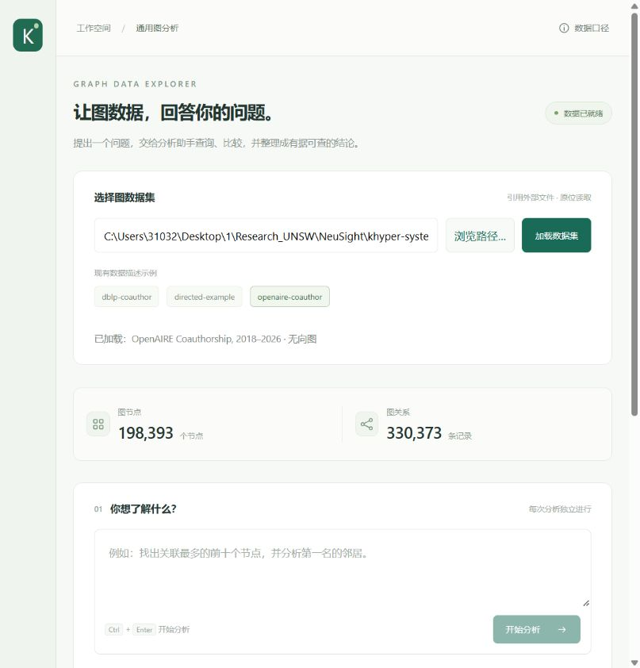

# KHyper System

本地通用图分析工作空间：选择外部图数据集，向单个 agent 提问，调用 C++ 图统计工具并生成带数据依据的报告。



## Windows 快速开始

### 1. 安装环境并克隆仓库

需要 Windows x64、Git、Python 3.12+（x64）、CMake 3.20+，以及 Visual Studio 2022 或其 Build Tools。在 Visual Studio Installer 中安装 **使用 C++ 的桌面开发**，确保包含 MSVC x64 编译工具和 Windows SDK。打开新的 PowerShell，确认 `python --version` 和 `cmake --version` 可以运行。

```powershell
git clone https://github.com/Yalong-Zhang/khyper-system.git
cd khyper-system
```

后面的命令都在 `start.ps1` 所在的项目目录运行。

### 2. 创建本地配置

运行 `notepad .\config.yaml`。如果记事本提示文件不存在，选择创建。复制下面的**完整内容**，以 UTF-8 保存。确认文件名是 `config.yaml`，扩展名没有被记事本加成 `.txt`。

```yaml
server:
  host: "127.0.0.1"
  port: 8765

llm:
  api_key: ""
  url: ""
  model_name: ""
  timeout_seconds: 90

graph:
  worker: ".runtime/build/Release/khyper_worker.exe"
  startup_timeout_seconds: 600
  tool_timeout_seconds: 30

agent:
  max_tool_calls: 8
  max_model_calls: 8
  task_timeout_seconds: 300
```

首次使用只需填写 `llm` 下的三个空字符串。填入你的 API key、服务商给出的 Chat Completions 基础 URL 或完整的 `/chat/completions` 地址，以及服务商提供的准确模型 ID。所选模型及接口必须支持函数工具调用（`tools` / `tool_calls`）。

`config.yaml` 已被 Git 忽略，真实密钥保存在本地。已有配置时，在原文件内修改对应项即可。修改后重启服务。三个模型字段留空时仍可启动、加载数据和运行本地检查，网页提问需要有效的模型配置。

### 3. 安装依赖并启动

```powershell
powershell -NoProfile -ExecutionPolicy Bypass -File .\setup.ps1
powershell -NoProfile -ExecutionPolicy Bypass -File .\start.ps1
```

安装脚本会建立 `.venv`、安装 Python 依赖并编译 C++ worker。Arrow/Parquet 的 DLL 会和 worker 一起放在 `.runtime/build/Release/`。构建完成后，启动脚本会打开浏览器。也可手动访问 [本地 KHyper 页面](http://127.0.0.1:8765)。保持终端运行，按 Ctrl+C 停止服务。若端口被占用，在启动命令末尾加 `-Port 8770`，并访问新端口。

### 4. 加载示例并运行第一次分析

`examples/datasets/` 提供一份人才流动有向图，包含 `directed-example.json` 和它引用的两份 Parquet 表。描述文件与数据表放在同一目录，克隆后即可直接加载。

1. 在网页的示例列表中点击 **directed-example**，再点 **加载数据集**。也可以手动选择 `examples/datasets/directed-example.json`。
2. 加载成功后，页面应显示 **788,007 个节点、2,210,046 条边**。
3. 配好模型后，可以问「哪些公司的流入权重最高？列出前五名。」

如果想先检查数据加载和图统计，可以在项目目录运行以下命令，无需调用模型 API。

```powershell
.\.venv\Scripts\python.exe backend\maintenance\check_graph.py examples\datasets\directed-example.json
```

换成自己的数据时，按 [数据集格式](docs/DATASET_FORMAT.md) 创建描述文件并在页面选择它。支持 Parquet 和 TSV 节点表及边表，表路径相对于描述文件所在目录解析。加载时直接读取原文件。

## 当前能力

- 有向图：入度、出度、总度、不同邻居并集，入／出强度、总强度、净入强度。
- 无向图：度数、强度和邻居，agent 只获得适用的指标与方向。
- 加权与不加权查询提供独立工具；名称或外部 ID 检索、排名、节点统计、邻居查询均为通用接口。
- 外部节点 ID 使用十进制字符串，支持 OpenAIRE 的大整数 ID，避免浏览器精度损失。
- 数据源必须是已准备好的简单图：自环、重复边、缺失端点和非法字段会被拒绝，不自动清洗。
- 读取进度、校验、就绪、失败状态可见；分析或加载中禁止切换。切换成功开始加载时清空旧报告，失败不会激活半张图。
- 每次分析独立，报告不落盘；刷新页面保留服务进程中的当前图，但不会恢复报告。重启后需重新选择。
- 字段认识：逻辑字段／物理列映射、标量类型、允许空值情况，以及完整扫描得到的空值数量和少量取值示例。
- 通用查询：节点／边属性筛选、端点属性筛选、字段投影和排序；支持 AND 与 eq/ne/in/gt/gte/lt/lte/is_null/is_not_null。
- 分组统计：节点／边分组、count/sum/avg/min/max，先计算全部匹配记录再限制输出行数。
- 排名支持候选节点属性筛选；邻居支持邻居属性筛选。指标仍基于完整图，邻居 share 分母仍为完整方向权重。
- 暂无中心性、社区发现、roll-up、OR、诱导子图计算或跨任务追问。

## 文件组织

```text
backend/                 后端服务、agent、数据加载与工具
  native/
    src/                 C++ 图加载和统计实现
    vendor/              KHyperGraph 核心与 JSON 依赖
  skills/                agent 分析规则与自动生成的英文工具参考
  maintenance/           数据检查及加载测速工具
  serve.py               启动服务与打开浏览器
  pick_dataset.py        本机文件选择窗口
frontend/                数据集选择、进度、报告和依据表
examples/datasets/       人才流动示例的描述文件和 Parquet 数据
tests/                   Python 与 C++ 测试
docs/                    架构、数据格式及验证说明
.runtime/                自动生成的缓存、构建产物及临时记录
.venv/                   项目 Python 运行环境
```

## 验证

以下命令不消耗模型 API：

```powershell
.\.venv\Scripts\python.exe -m pytest -q
```

测试验证外部文件内容不变、有向和无向指标、两种格式、大整数 ID、孤立节点、错误图拒绝、agent 与 HTTP 调度。`/docs` 为 API 文档。实现细节见 [dataset-selection.md](docs/dataset-selection.md)。

加载性能的优化说明、实测结果及复测命令见 [loading-performance.md](docs/loading-performance.md)。

“浏览路径”对话框出现在后端运行的电脑上，适合当前本机使用；远程服务请填后端可访问的路径。文件选择取消后不改变当前数据集。

## 更新后页面显示旧样式

停止旧服务，重新运行 start.ps1，再刷新页面。HTML 自动为 CSS/JS 加上内容版本号，静态资源同时使用 no-store，避免新页面混用旧脚本和样式。Windows 浏览路径使用系统原生对话框；取消会恢复按钮，超过三分钟未选择会提示超时。

## 临时文件与缓存

Python 字节码缓存与 pytest 缓存统一写入 `.runtime/python/` 和 `.runtime/pytest/`，不再在源码目录生成 `__pycache__` 或在根目录生成 `.pytest_cache`。`setup.ps1` 会将内置缓存规则安装到项目虚拟环境，`start.ps1` 会在缺失时自动调用安装，因此直接调用 `.venv/Scripts/python.exe` 也使用此规则。`.runtime/build/` 存放 C++ 构建产物，`config.yaml` 中的 worker 路径也指向这里。停止服务后可清理 `.runtime/`；删除构建产物后，下次启动会自动重新编译。`.venv/` 为 Python 运行环境。

## 查询工具与英文参考

工具注册表位于 `backend/tools.py`，统一维护模型工具 schema、递归参数校验、用途、示例和页面步骤说明。英文参考 [tool_reference.md](backend/skills/tool_reference.md) 由注册表生成，agent 在每次分析时会读取它。修改工具后运行 `.\.venv\Scripts\python.exe -m backend.tools --write-reference`；`setup.ps1` 也会自动生成。C++ 查询实现位于 `backend/native/src/query_engine.cpp`。

使用与统计口径详见 [query-tools.md](docs/query-tools.md)。例如可以询问“有哪些字段，哪些字段有空值？”、“按某个类别统计节点数量”、“在指定类别的节点中按完整图强度排名”、“统计满足两端属性条件的边数及权重总和”。字段名和属性取值均以当前数据集为准。
